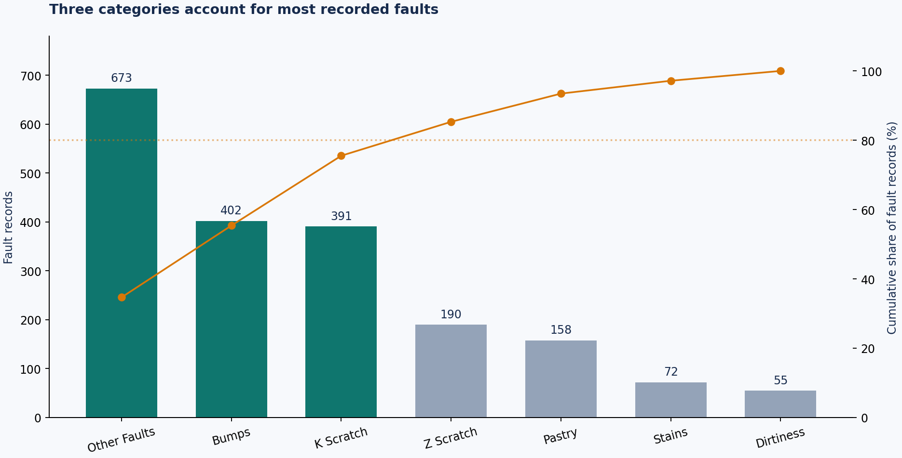

# Steel Quality Analytics

**A reproducible manufacturing data analysis portfolio project using Python, SQL, and Streamlit.**

Analyze 1,941 labeled steel surface fault observations to identify inspection priorities, compare fault composition, and distinguish frequency from pixel-area concentration.

> This is an independent analysis of a public research dataset, not company employment or a deployed factory improvement. The dataset contains fault observations only. It cannot estimate production rejection rates, downtime, physical scrap area, or savings.



## Business question

Where should a quality team focus its next investigation, based on the composition of its recorded faults?

A quality engineer is the intended stakeholder. The deliverable is a descriptive investigation brief and an interactive explorer—not a causal diagnosis or predictive maintenance system.

## Findings

| Finding | Evidence | Proposed next step |
|---|---|---|
| Other Faults, Bumps, and K Scratch dominate the sample | 1,466 of 1,941 observations: **75.53%** | Start a focused review of these categories; the first four categories reach 85.32% |
| Frequency and pixel area tell different stories | K Scratch: **20.14%** of records, **81.08%** of summed defect pixel areas | Examine the imaging scale and inspect representative K Scratch cases; do not equate pixels with cost |
| Fault mix differs across steel types | Bumps: **35.91%** of A300 faults versus **10.57%** of A400 faults | Investigate process and sampling differences before attributing effects to steel type |
| The residual category is large | Other Faults: **673 records, 34.67%** | Review labeling definitions and consider useful subcategories |

**Denominators:** overall shares use all 1,941 observations; steel comparisons use 777 A300 and 1,164 A400 observations. The dashboard recomputes denominators after filtering. These findings describe this sample only.

## What this demonstrates

- **Data preparation:** schema checks, null/duplicate audit, one-hot label validation, tidy categorical fields, source-row lineage.
- **SQL:** grouped aggregation, CTEs, window functions, cumulative Pareto shares, within-group percentages, ranking.
- **Python:** pandas transformations, SQLite integration, reusable functions, Matplotlib visualization.
- **Communication:** stakeholder-oriented findings, explicit metric definitions, recommendations tied to evidence.
- **Dashboard:** steel/thickness filters, recalculated metrics, sample sizes, empty-selection handling, downloadable filtered records.
- **Reproducibility:** bundled source data, integrity hashes, executable pipeline, tests, executed notebook, GitHub Actions workflow.

## Run locally

Python **3.11 or 3.12** recommended. Run commands from this repository's root folder.

```bash
python -m venv .venv
```

Activate the environment:

```bash
# Windows PowerShell
.venv\Scripts\Activate.ps1

# macOS / Linux
source .venv/bin/activate
```

Then:

```bash
python -m pip install -r requirements.txt
python -m src.pipeline
python -m unittest discover -s tests -v
python -m streamlit run app.py
```

Open the local URL printed by Streamlit. Data and outputs are already included, so dashboard use does not require downloading the source again. Internet is needed only to install dependencies or re-download source data.

To work with the notebook in VS Code or Jupyter, install `requirements-dev.txt` and select the project environment as the Python kernel. The committed notebook includes executed outputs for GitHub viewing. You can also regenerate them with `python scripts/execute_notebook.py` after installing the development requirements. This runs cells in-process without requiring kernel sockets.

## Repository guide

| Path | Purpose |
|---|---|
| `app.py` | Interactive dashboard |
| `src/pipeline.py` | Validation, cleaning, SQL execution, exports, charts |
| `sql/analysis.sql` | Five standalone analytical queries, SQLite dialect |
| `notebooks/01_quality_analysis.ipynb` | Executed analysis and interpretation |
| `data/raw/` | Original UCI files; kept unchanged |
| `data/processed/faults_clean.csv` | Tidy data for BI tools and Python |
| `data/processed/quality.db` | SQLite database with the `faults` table |
| `reports/` | SQL result tables, audit, metrics, and stakeholder brief |
| `reports/figures/` | Three ready-to-view charts |
| `docs/` | Data dictionary, metric definitions, GitHub guide, interview notes |
| `tests/` | Pipeline and dashboard regression checks |

## Method

1. Read 34 source fields: 27 measurements/indicators and seven fault labels.
2. Validate missing/non-finite values, binary indicators, positive areas/thickness, and coordinate order. Record duplicates without silently deleting observations.
3. Convert one-hot labels to a single `fault_type`. Display source `K_Scatch` as `K Scratch` without altering the raw data.
4. Add a source-row `record_id`, `steel_type`, analyst-defined thickness bands, and log pixel area. Preserve other source measurements.
5. Load a SQLite table. Execute named SQL analyses and export CSV results.
6. Compare SQL aggregates with independent pandas calculations in automated tests.
7. Build descriptive charts and a filterable dashboard.

No imputation or outlier removal was needed or performed. Large pixel areas remain because unusual defects are relevant, and the source provides no basis to call them errors. Medians are presented alongside totals.

## Scope and limitations

No timestamps, shift IDs, machine IDs, production totals, defect-free controls, measured downtime, or cost fields are available. Row order is not a time series. Thickness units are not specified in the source, so no millimeter conversion is assumed. Pixel-area totals are sums across observed defects, not unique physical surface coverage. The sampling process may affect category shares; no population-level confidence claims or causal effects are asserted.

A next phase would request inspection totals by production batch, unique plate IDs, timestamps, line/shift identifiers, calibrated image scale, severity labels, and rework/scrap costs. Those would support operational rates and validated impact estimates.

## Data source and licenses

Buscema, M., Terzi, S., & Tastle, W. (2010). *Steel Plates Faults* [Dataset]. UCI Machine Learning Repository. DOI: [10.24432/C5J88N](https://doi.org/10.24432/C5J88N).

- [Dataset page](https://archive.ics.uci.edu/dataset/198/steel+plates+faults)
- [Original download](https://archive.ics.uci.edu/static/public/198/steel+plates+faults.zip)
- Source data: [CC BY 4.0](https://creativecommons.org/licenses/by/4.0/).
- Project code: MIT, see `LICENSE`. Dataset attribution and transformations: `data/README.md`.

See [the findings brief](reports/FINDINGS.md), [metric definitions](docs/METRICS.md), and [upload instructions](docs/GITHUB_AND_CV.md).
